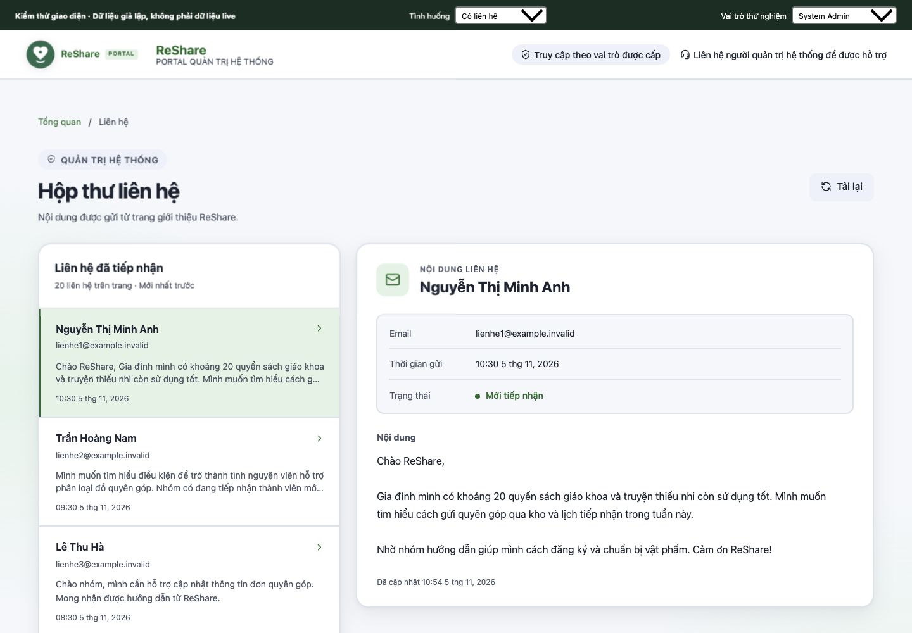
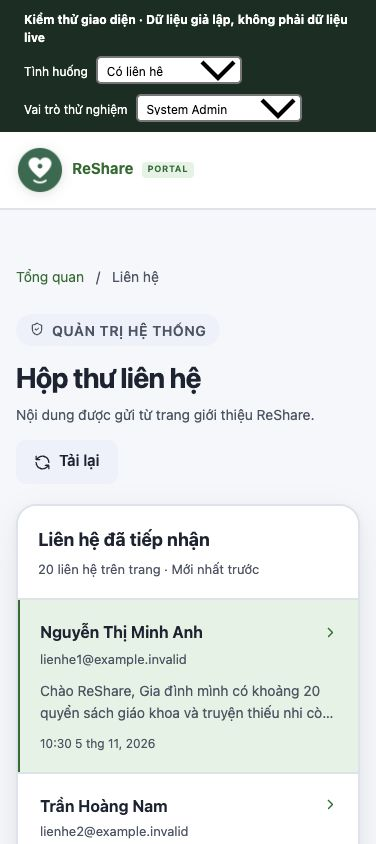

# Hộp thư liên hệ cho System Admin

Phạm vi: xem liên hệ từ landing page qua API thật, phân trang, xem chi tiết và tải lại. Chỉ System Admin có phân quyền đang hoạt động được truy cập. Chưa có đổi trạng thái, gửi email, xóa hoặc xuất dữ liệu.

## Cách sử dụng

1. Đăng nhập Web Admin bằng System Admin đang hoạt động.
2. Chọn **Liên hệ từ landing** trong menu Tổng quan, hoặc mở `/admin/contacts`.
3. Danh sách hiển thị tên, email, nội dung tóm tắt và thời gian gửi; chi tiết hiển thị toàn bộ nội dung thuần văn bản. Thời gian hiển thị theo múi giờ Việt Nam.
4. Mỗi trang tối đa 20 liên hệ, mới nhất trước. Dùng **Trước / Sau** để chuyển trang. **Tải lại** trở về trang đầu để xem dữ liệu mới.

Desktop dùng hai cột danh sách và chi tiết. Mobile mở chi tiết riêng, có nút quay lại danh sách. Giao diện dùng `AuthShell`, `AuthIcon` và các biến màu/chữ hiện có của hệ thống, không thêm thư viện.

## API và phân quyền

`GET /v1/contact?limit=20&cursor=<nextCursor>` dùng Firebase ID token trong `Authorization: Bearer ...`. Endpoint lấy từ `VITE_CONTACT_API_URL` (cùng cấu hình với form landing); nếu chưa đặt thì dùng `VITE_ADMIN_API_BASE_URL` + `/v1/contact`, sau đó mới đến Render URL mặc định hiện có.

Phản hồi thành công:

```json
{
  "contacts": [{
    "id": "contact-document-id",
    "name": "Tên người gửi",
    "email": "qa@example.invalid",
    "message": "Nội dung liên hệ",
    "status": "new",
    "createdAt": "2026-11-05T03:00:00.000Z"
  }],
  "pageSize": 20,
  "hasMore": false,
  "nextCursor": null
}
```

- `limit` mặc định 50 để giữ giới hạn cũ; chấp nhận số nguyên 1–50. Web luôn yêu cầu 20. Query trùng `limit`/`cursor`, limit sai hoặc cursor không hợp lệ trả 400.
- Cursor dùng helper hiện có, gắn với hộp thư liên hệ; sắp theo `createdAt desc`, document ID `desc` để phân trang ổn định cả khi trùng thời gian. Mỗi trang truy vấn tối đa `limit + 1` bản ghi, thêm một lần đọc cursor nếu có và hai lần kiểm tra phân quyền.
- API xác minh phiên và đọc `staff_assignments` trước truy vấn, kiểm tra lại quyền sau truy vấn. Không có phiên trả 401; Warehouse Admin, người dùng thường hoặc quyền bị thu hồi trả 403.
- DTO chỉ trả các trường cần hiển thị, không trải toàn bộ document. `createdAt` trả ISO hoặc `null`.
- Route guard và menu chỉ cho System Admin. Component hủy request, xóa dữ liệu riêng tư khi tài khoản/quyền thay đổi hoặc rời trang; phản hồi cũ không ghi đè request mới.
- Có trạng thái đang tải, rỗng, lỗi API/kết nối, phản hồi sai cấu trúc, hết phiên và mất quyền. Không dùng dữ liệu mẫu làm fallback. Nội dung người gửi được Vue escape, không dùng `v-html`.
- `POST /v1/contact`, Firestore Rules và cấu hình index giữ nguyên. Truy vấn dùng hướng document ID giống hướng `createdAt`, phù hợp thứ tự `__name__` mặc định của index đơn trường. Emulator đã chạy được; chưa xác minh index của dự án live.

## Kiểm chứng ngày 05/11/2026

Base: `origin/dev` tại `547b79778c807d9d2fd80bf2db3ae0cc7f941936`. Các kết quả dưới đây là kiểm tra local; không chứng minh bản đang triển khai hoặc dữ liệu live.

| Kiểm tra | Kết quả |
| --- | --- |
| Firestore Rules, project `demo-reshare` | 14/14 pass, 0 skip |
| Backend, có Firestore Emulator | 114/114 pass, 0 skip |
| Web | 94/94 pass, 0 skip |
| Web production build | Pass; còn cảnh báo chunk >500 kB hiện có |
| API phân trang trên Emulator | 55 liên hệ cùng Timestamp, 3 trang 20/20/15, không lặp/mất bản ghi trong tập kiểm thử |
| Route guard với route mới | System Admin được vào; Warehouse Admin, donor, quyền bị thu hồi và khách bị chặn đúng nhánh |
| Browser UI desktop | 1440×1000 CSS px: danh sách/chi tiết, 3 trang, trước/sau, tải lại về trang 1 |
| Browser UI mobile | iframe cùng nguồn rộng 376×844 CSS px: không tràn ngang; mở chi tiết/quay lại giữ lựa chọn và focus |
| Browser UI trạng thái | Đang tải, rỗng, 500, 401, 403, phản hồi sai cấu trúc; không để lại danh sách cũ |
| Browser UI an toàn nội dung | Chuỗi `` hiển thị nguyên văn, không tạo thẻ ảnh |
| Browser UI mất quyền | Đổi sang Warehouse Admin hoặc thu hồi quyền làm ẩn/xóa nội dung liên hệ ngay |

Browser QA dùng **component, service và composable thật** trong harness local tách ngoài repo, với auth và HTTP response giả lập, email `example.invalid`. Router trong harness dùng stub; route guard thật được kiểm tra riêng. Không dùng tài khoản live và không gửi form liên hệ thật. Không coi đây là kiểm thử E2E production hay kiểm thử trên điện thoại vật lý. Harness và các module giả lập không nằm trong source sản phẩm.

Ảnh kiểm thử desktop (dữ liệu giả lập):



Ảnh kiểm thử mobile (dữ liệu giả lập):



Lệnh kiểm tra:

```sh
npm run test:all:emulator
npm --prefix ReShare-Web test
npm --prefix ReShare-Web run build
git diff --check
```

## Lưu ý khi triển khai sau review

Triển khai **backend trước Web**, vì Web cần metadata phân trang mới; API cũ chỉ trả `contacts` sẽ được hiển thị thành lỗi dữ liệu thay vì một danh sách trống gây hiểu nhầm. Đảm bảo endpoint Web trỏ đúng backend cùng môi trường với form landing.

PR này chưa triển khai, chưa merge, chưa thay đổi Firebase live. Sau khi duyệt và triển khai cần đăng nhập bằng System Admin thật, xác nhận liên hệ được phép dùng trong demo xuất hiện, kiểm tra tài khoản không đủ quyền và luồng hết phiên trên môi trường đó. Không bao gồm sửa cột “Người gửi” của hàng đợi quyên góp hoặc các thay đổi nghiệp vụ khác.
