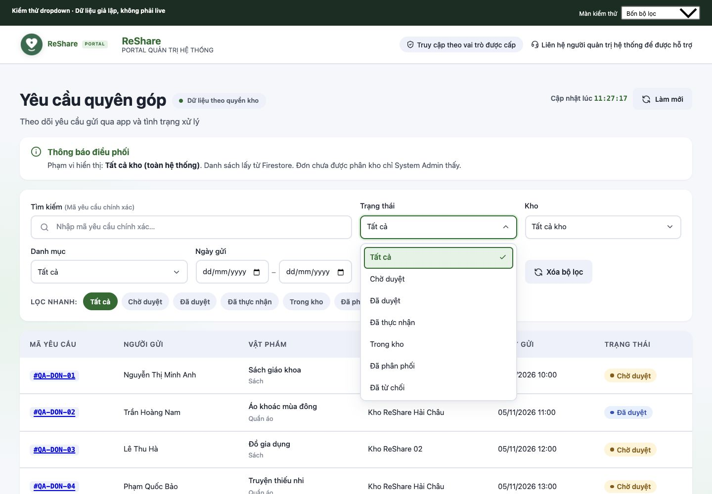
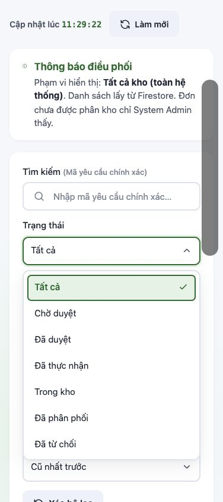

# Dropdown bộ lọc theo UI ReShare

Trước đây khung bộ lọc đã có style ReShare, còn popup của `<select>` do trình duyệt/hệ điều hành vẽ nên có thể hiện nền xám như ảnh mentor góp ý. Bản sửa thay đúng 4 bộ lọc tại màn **Yêu cầu quyên góp**: Trạng thái, Kho, Danh mục và Sắp xếp.

## Thay đổi

- Component Vue dùng chung `src/admin/shared/AdminSelect.vue`, không thêm package.
- Dùng màu, font, bo góc và shadow kế thừa từ `AuthShell`. Menu trắng, lựa chọn hiện tại nền xanh nhạt và dấu tích; mục đang điều hướng bằng bàn phím có viền xanh.
- Chọn bằng chuột, phím mũi tên, Home/End, Enter/Space; Tab chốt mục đang điều hướng rồi chuyển focus. Esc hoặc bấm lại trigger/bấm ngoài đóng menu mà không đổi lựa chọn.
- Gõ đầu nhãn để tìm nhanh, hỗ trợ bỏ dấu tiếng Việt và lặp chữ để duyệt các nhãn cùng chữ đầu.
- Giữ focus trên combobox, liên kết nhãn/listbox/option bằng ARIA. Tương tác tham khảo [mẫu select-only combobox của W3C](https://www.w3.org/WAI/ARIA/apg/patterns/combobox/examples/combobox-select-only/); chưa xác nhận bằng screen reader.
- Menu tối đa 320px, cuộn bên trong; tự đặt phía trên khi phía dưới thiếu chỗ. Mục đang điều hướng được đưa vào vùng nhìn thấy. Có disabled toàn control, disabled từng option và thông báo không có lựa chọn.
- Đóng menu khi focus đi ra ngoài; dọn event listener và timer khi component bị tháo khỏi trang. Giảm chuyển động theo `prefers-reduced-motion`.

Giữ nguyên `v-model`, giá trị option, service/API, phân quyền, tìm kiếm, chip lọc nhanh, ngày tháng và các dropdown ở màn khác. Component hiện chỉ được tích hợp trong 4 bộ lọc này; không quảng bá như một thư viện form hoàn chỉnh (chưa có native required/form submission). Panel dùng vị trí fixed và kế thừa theme ngay trong DOM của AuthShell; cần kiểm tra lại nếu tái sử dụng trong ancestor có transform/clip khác.

## Kiểm chứng ngày 05/11/2026

Base riêng `origin/dev` tại `547b79778c807d9d2fd80bf2db3ae0cc7f941936`, không chứa phần Hộp thư liên hệ (#76) hoặc hiển thị người gửi (#77).

| Kiểm tra | Kết quả |
| --- | --- |
| Web regression suite | 88/88 pass, 0 fail, 0 skip |
| Web production build | Pass, còn cảnh báo chunk >500 kB hiện có |
| Browser QA | 13 kịch bản pass; chi tiết trong `browser-qa.json` |
| Desktop | 1440×1000 CSS px; chọn trạng thái/kho/danh mục/sắp xếp cập nhật đúng các dòng fixture |
| Bàn phím | Arrows, Home/End, Enter, Tab, Esc, gõ không dấu và lặp chữ; focus không bị mất |
| Popup | Chỉ mở một menu, bấm ngoài đóng; danh sách 31 kho cuộn có giới hạn; tên kho dài xuống dòng |
| Viewport thấp / resize | 640px: menu mở lên trên và không bị cắt; tăng chiều cao lên 1000px: menu đang mở định vị lại xuống dưới |
| Edge cases | Rỗng có thông báo; control disabled không mở; phím bỏ qua option disabled |
| Mobile responsive | iframe 376×844 CSS px; popup trong viewport, không làm trang tràn ngang, chọn trạng thái lọc đúng |

Browser QA dùng trang hàng đợi/component/service thật với Firebase SDK/auth/database fixture trong harness local nằm ngoài repo. Không gọi Firebase live hoặc thêm mock/fallback vào source sản phẩm. Chưa kiểm tra trên điện thoại vật lý, nhiều trình duyệt hoặc bằng VoiceOver/NVDA. Không thay đổi backend nên không chạy lại bộ kiểm thử backend/Rules.

Ảnh desktop (dữ liệu giả lập):

Ảnh responsive 376px (dữ liệu giả lập):

Kiểm tra lại bằng `npm --prefix ReShare-Web test`, `npm --prefix ReShare-Web run build` và các bước mở/chọn từng bộ lọc, dùng bàn phím, bấm ngoài, reset, đổi kích thước cửa sổ. Cần xác nhận thêm với dữ liệu/tài khoản thật sau khi review và triển khai.

PR này chỉ là thay đổi UI Web, chưa merge hoặc triển khai. Không sửa dữ liệu, dependency hay cấu hình hệ thống.
