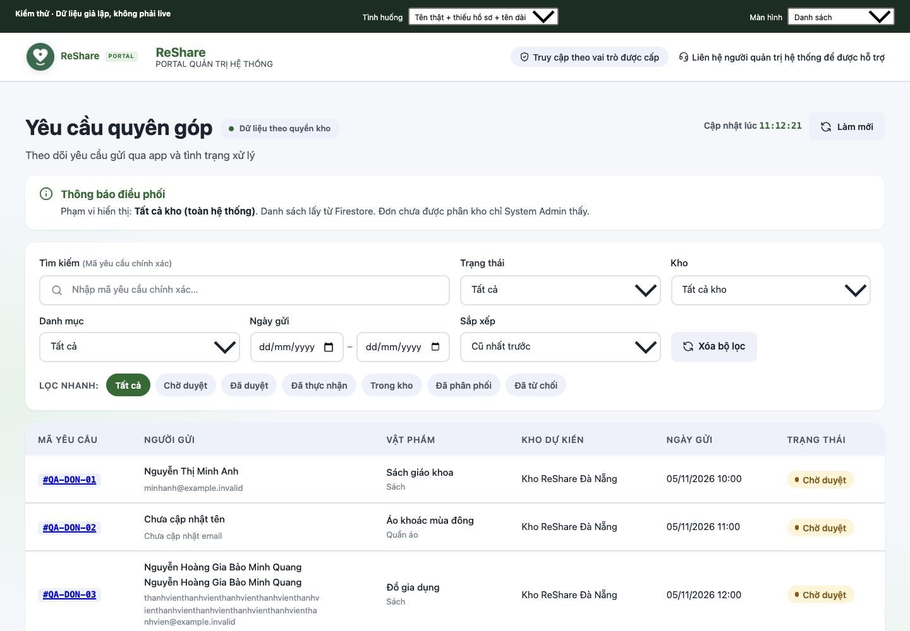

# Hiển thị người gửi quyên góp

## Kết quả và phạm vi

Cột **Người gửi** trước đây lấy `donorId` khi đơn không có `donorName`, nên hiển thị Firebase Auth UID. Bản sửa lấy tên/email qua backend từ hồ sơ thật, giữ giao diện bảng hiện có:

- Tên ở dòng chính, email ở dòng phụ; chuỗi dài tự xuống dòng trong ô.
- Ưu tiên `users/{donorId}.displayName`, sau đó đến `donations.donorName` nếu có. Tên trùng chính UID không được dùng làm tên hiển thị.
- Thiếu tên: **Chưa cập nhật tên**. Thiếu email: **Chưa cập nhật email**. Không tạo tên/email giả.
- Chi tiết đổi nhãn **Donor** thành **Họ và tên**, thêm **Mã tài khoản (UID)** riêng để đối chiếu; vẫn giữ `donorId` gốc.
- Phiếu thực nhận dùng cùng quy tắc tên, không lấy UID thay tên.
- Khi phân quyền thay đổi, xóa danh sách cũ ngay trước khi tải phạm vi mới.

Không đổi UID/UUID, cấu trúc database, dữ liệu đã lưu, iOS, logic duyệt/nhập kho hoặc các màn demo. Tên phản ánh hồ sơ hiện tại; đây không phải migration lưu tên lịch sử trên từng đơn.

## API đọc người gửi

`POST /v1/admin/donations/senders`, Firebase ID token trong header `Authorization: Bearer ...`:

```json
{ "donationIds": ["donation-document-id"] }
```

```json
{
  "senders": [{
    "donationId": "donation-document-id",
    "donor": { "name": "Tên người gửi", "email": "qa@example.invalid" }
  }]
}
```

Endpoint chỉ đọc, tối đa 10 ID khác nhau mỗi request, tương ứng giới hạn trang hàng đợi hiện có. Backend xác minh phiên, đọc lại phân quyền và kiểm tra toàn bộ đơn trong transaction trước khi đọc hồ sơ. System Admin xem được đơn chưa phân kho; Warehouse Admin chỉ xem đơn tại kho đang được phân công. Một ID ngoài phạm vi làm cả request trả 403. ID không tồn tại trả 404; input sai trả 400; không có phiên trả 401.

Một trang chỉ gọi một request bổ sung; các đơn cùng donor dùng chung một lần đọc hồ sơ. Response chỉ có `donationId`, tên và email, không trả điện thoại/địa chỉ hoặc toàn bộ profile. Không mở quyền đọc trực tiếp collection `users` cho Web. Chi tiết đơn dùng cùng helper tên ở backend.

Service áp dụng cho cả danh sách và tìm bằng mã yêu cầu chính xác. Trang rỗng không gọi API người gửi. Lỗi API/phân quyền hoặc response thiếu/sai được đưa vào trạng thái lỗi hiện có của hàng đợi; không âm thầm dùng UID làm fallback.

## Kiểm chứng ngày 05/11/2026

Nhánh riêng từ `origin/dev` tại `547b79778c807d9d2fd80bf2db3ae0cc7f941936`. Không gộp thay đổi Hộp thư liên hệ của PR #76 vào đây.

| Kiểm tra | Kết quả |
| --- | --- |
| Rules trên Firestore Emulator `demo-reshare` | 14/14 pass, 0 skip |
| Backend có Emulator | 115/115 pass, 0 skip |
| Web | 91/91 pass, 0 skip |
| Web production build | Pass; còn cảnh báo chunk >500 kB hiện có |
| API người gửi | Hồ sơ thật trong fixture, thiếu hồ sơ, tên trắng/trùng UID, deduplicate donor, DTO tối thiểu, không ghi dữ liệu |
| Phân quyền API | System Admin, Warehouse Admin đúng/sai kho, đơn chưa phân kho, donor, quyền bị thu hồi, không phiên; đổi quyền giữa xác thực và transaction bị chặn |
| Browser desktop 1440px | Tên/email, tên/email dài, thiếu hồ sơ; chi tiết có UID riêng; tìm đơn chính xác |
| Browser mobile iframe 376px | Trang không tràn ngang; bảng giữ cuộn ngang bên trong wrapper hiện có; nội dung người gửi xuống dòng trong ô |
| Browser trạng thái | Loading, rỗng, API lỗi, mất quyền; không hiển thị tên/email cũ khi quyền bị thu hồi, kể cả response đang chờ |

Browser QA chạy component hàng đợi/chi tiết, service và backend handler thật trong harness local tách ngoài repo; thay Firebase SDK/auth/database bằng fixture kiểm thử. Hồ sơ dùng tên giả lập và email `example.invalid`. Không gọi Firebase live, không phải nghiệm thu E2E production hoặc thiết bị thật. Riêng transaction/profile join cũng đã chạy trên Firestore Emulator.



Lệnh kiểm tra:

```sh
npm run test:all:emulator
npm --prefix ReShare-Web test
npm --prefix ReShare-Web run build
git diff --check
```

## Sau review

Triển khai backend trước Web để có endpoint mới. Backend chưa cập nhật sẽ khiến hàng đợi hiển thị lỗi tải thay vì tiếp tục hiện UID. Sau triển khai cần kiểm tra bằng tài khoản System Admin và Warehouse Admin thật với các đơn được phép xem. PR chưa merge, chưa triển khai hoặc sửa dữ liệu live; không thêm package hay đổi Firestore Rules/index.
